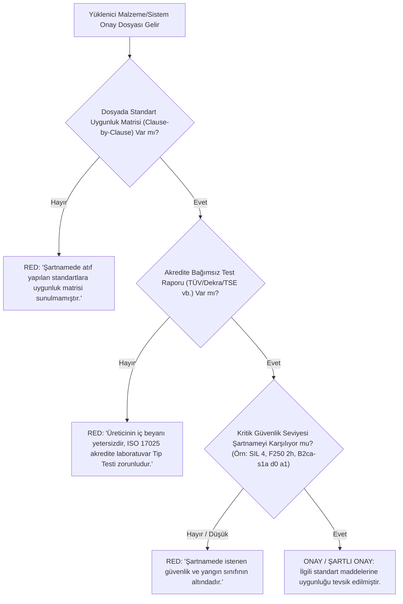

# İSTANBUL METRO VE RAYLI SİSTEMLER ELEKTROMEKANİK STANDARTLAR MASTER KATALOĞU
## (Sinyalizasyon, Zayıf Akım/Haberleşme, Elektrik/Cer Gücü, Mekanik/Havalandırma/Yangın)

Bu katalog; İBB Raylı Sistem Daire Başkanlığı, AYGM ve uluslararası metro yapım standartları (CENELEC, IEC, ISO, NFPA, EN, TSI) esas alınarak hazırlanmış, yüklenici malzeme ve sistem tasarım onaylarında aranacak zorunlu standartlar listesidir.

---

## 1. SİNYALİZASYON VE TREN KONTROL SİSTEMLERİ (CBTC / ATC / IXL)

| Standart Kodu | Standart Adı | Kapsamı ve İnceleme/Kabul Kriteri | Zorunlu Seviye |
| :--- | :--- | :--- | :--- |
| **EN 50126-1 / 2** | Demiryolu Uygulamaları - RAMS Şartnamesi ve İspatı | Güvenilirlik, Kullanılabilirlik, Bakım Yapılabilirlik ve Emniyet. V-Modeli yaşam döngüsü doğrulaması ve Hazard Log (Tehlike Kütüğü) kapatma onayları. | Zorunlu (Sistem Geneli) |
| **EN 50128** | Demiryolu Kontrol ve Koruma Yazılımları | CBTC, Anklaşman (IXL), ATS ve Araç Üstü (ATC/ATP/ATO) yazılımlarının doğrulanması, bağımsız V&V testleri. | **SIL 4** (Emniyet Yazılımları) |
| **EN 50129** | Demiryolu Elektronik Emniyet Sistemleri | Sinyalizasyon donanımı arıza güvenliği (Fail-Safe), Safety Case (6 Bölümlük Emniyet Dosyası) ve ISA Uygunluk Raporu. | **SIL 4** (Emniyet Donanımı) |
| **EN 50159** | Güvenlik İlgili İletim Sistemlerinde Haberleşme | Telsiz (WLAN/LTE) ve kablolu iletim üzerinden sinyalizasyon veri güvenliği. Kriptografik imza, sequence kontrolü, paket kaybı ve siber tehdit koruması. | Kategori 1-2-3 (Açık/Kapalı Ağ) |
| **IEEE 1474.1 / 2 / 3** | İletişim Tabanlı Tren Kontrolü (CBTC) Fonksiyonel ve Performans Standardı | CBTC sistem mimarisi, tren konum belirleme (± cm hassasiyet), hareket yetkisi (Movement Authority), headway (tren aralığı) kriterleri. | Sürücüsüz Metro CBTC |
| **IEC 62290-1 / 2 / 3** | Kentsel Demiryolu Otomasyonu (UGTMS / CBTC) | Sürücüsüz İşletme Otomasyon Düzeyleri (GoA 1-4). İkitelli-Ataköy hattı için tam sürücüsüz **GoA 4 (UTO - Unattended Train Operation)** gereksinimleri. | **GoA 4 (Tam Otomasyon)** |
| **EN 50125-1 / 3** | Demiryolu Çevresel Şartları | Tünel ve ray boyundaki sinyal ekipmanlarının (balizler, aks sayaçları, makas motorları, sinyal fenerleri) sıcaklık, nem, titreşim ve toz dayanımı. | Tünel İçi / Dışı Ortam |
| **EN 50124-1 / 2** | Yalıtım Koordinasyonu | Sinyalizasyon ve elektronik kartların aşırı gerilim darbesi ve dielektrik dayanım testleri. | Temel İzolasyon |

---

## 2. ZAYIF AKIM, HABERLEŞME, SCADA VE İSTASYON ELEKTRONİK SİSTEMLERİ

| Standart Kodu | Standart Adı | Kapsamı ve İnceleme/Kabul Kriteri |
| :--- | :--- | :--- |
| **EN 62267** | Kentsel Kılavuzlu Otomatik Ulaşım Sistemleri (AUGT) Emniyet Şartları | Platform Ayırıcı Kapı Sistemleri (PAK / PSD) ile CBTC tren kapısı hizalama, açılma-kapanma kilitlemesi ve emniyet arayüzü (SIL 3 / SIL 4). |
| **NFPA 72** | Ulusal Yangın Alarm ve Sinyalizasyon Kodu | İstasyon ve tünel yangın algılama (duman, ısı, optik alev detektörleri), acil anons ve yangın kontrol paneli entegrasyonu. |
| **EN 54 Serisi** (EN 54-2, 4, 16, 24) | Yangın Tespit ve Yangın Alarm Sistemleri | EN 54-16 (Sesli tahliye kontrol ve anons donanımı), EN 54-24 (Seslendirme hoparlörleri yangın dayanım sertifikası). |
| **EN 60849 / ISO 7240-19** | Acil Durumlar İçin Ses Sistemleri | İstasyon acil tahliye anons sisteminde ses anlaşılabilirlik indeksi (STI - Speech Transmission Index > 0.50) akustik test şartı. |
| **EN 62676 Serisi** | Güvenlik Amaçlı Kapalı Devre Televizyon (CCTV) | IP kameraların çözünürlüğü, FPS değerleri, ONVIF Profile S/G/T uyumluluğu, NVR yedekliliği ve tünel aydınlatmasız gece görüş (IR) hassasiyeti. |
| **ETSI EN 300 392** | Karasal Hücresel Telsiz (TETRA) Şartnamesi | Tünel içi sızıntılı koaksiyel kablo (leaky feeder) ile telsiz kapsama alanı, kesintisiz acil durum emniyet haberleşmesi. |
| **IEC 60870-5-104 / IEC 61850** | Telekontrol ve Trafo SCADA İletişim Protokolleri | Trafo merkezleri, cer gücü ve hat boyu SCADA RTU/PLC haberleşmesinde standart endüstriyel açık protokol entegrasyonu. |
| **ISO/IEC 27001 & IEC 62443** | Endüstriyel Siber Güvenlik (OT Security) | Metro SCADA, CBTC ve Zayıf Akım kontrol ağlarının dış siber saldırılara karşı güvenliği, ağ segmentasyonu, firewall ve erişim kontrolü. |

---

## 3. ELEKTRİK, CER GÜCÜ VE AG/OG ENERJİ SİSTEMLERİ

| Standart Kodu | Standart Adı | Kapsamı ve İnceleme/Kabul Kriteri |
| :--- | :--- | :--- |
| **EN 50163** | Demiryolu Cer Besleme Gerilimleri | 750V DC / 1500V DC cer sistemi için nominal, en düşük ve en yüksek gerilim limitleri (750V için: Min 500V, Max 900V, Kısa süreli Max 1000V). |
| **EN 50122-1** | Elektriksel Güvenlik ve Topraklama | Yolcuların ve personelin dokunma gerilimi limitleri ($U_{te}$), adım gerilimi koruması, ray potansiyeli sınırlama cihazları (OVPD). |
| **EN 50122-2** | Doğru Akım (DC) Cer Sistemlerinde Kaçak Akım (Stray Current) Korozyonu | Tünel betonarme demirlerinin, su borularının ve çevre altyapının DC cer akımından korozyona uğramasını önleme, kaçak akım toplama hasırı testleri. |
| **EN 50328 / IEC 60146** | Demiryolu Cer Redresörleri ve Güç Elektroniği | 12 darbeli veya 24 darbeli cer redresör ünitelerinin aşırı yük sınıfları (Class VI: %100 sürekli, %150 2 saat, %300 1 dakika aşırı yük testi). |
| **IEC 60076-11** | Kuru Tip Dökme Reçineli Güç ve Cer Trafoları | Trafo merkezlerinde F1 yangın dayanımı, C2 iklim ve E2 çevre sınıflarına uygunluk, kısmi boşalma (partial discharge) test sertifikaları. |
| **IEC 62271-200 / 100** | Yüksek Gerilim ve Orta Gerilim (OG) Gaz Yalıtımlı Hücreler (GIS) | 34.5 kV gaz yalıtımlı şalt donanımları, vakumlu kesiciler, iç ark dayanım testi (IAC AFLR). |
| **IEC 61439-1 / 2** | Alçak Gerilim (AG) Dağıtım ve Kontrol Panoları | Form 4b tipi pano izolasyon bölmeleri, kısa devre dayanımı, sıcaklık artış sınırları. |
| **EN 50121-2 / 5** | Demiryolu Elektromanyetik Uyumluluk (EMC) | Cer gücü trafolarının ve kablolarının çevreye yaydığı manyetik alan emisyon limitleri ve bağışıklık (immunity) testleri. |
| **IEC 60364** | Binalarda Alçak Gerilim Elektrik Tesisatı | TN-S topraklama sistemi, artık akım koruma (RCD), kablo kesit tayini ve gerilim düşümü limitleri. |
| **IEC 62305** | Yıldırımdan Korunma ve Paratoner Tesisatı | İstasyon yerüstü girişleri ve havalandırma şaftlarında Faraday kafesi, parafudr koruması. |
| **IEC 62040-3** | Kesintisiz Güç Kaynakları (UPS) | Sinyal, SCADA ve acil aydınlatma UPS sistemlerinin VFI-SS-111 sınıfı (çift çevrim online), akü deşarj test raporları. |

---

## 4. MEKANİK, HAVALANDIRMA (TVS), YANGIN VE İSTASYON SİSTEMLERİ

| Standart Kodu | Standart Adı | Kapsamı ve İnceleme/Kabul Kriteri |
| :--- | :--- | :--- |
| **NFPA 130** | Sabit Güzergahlı Raylı Transit ve Yolcu Demiryolu Sistemleri Standardı | **Metro tasarımının kutsal kitabıdır.** Tünel duman tahliyesi kriterleri (kritik hava hızı - critical velocity), acil kaçış süreleri (istasyon boşaltma: 4 dakika peron, 6 dakika güvenli alan), yangın yükü hesapları. |
| **EN 12101-3** | Duman ve Isı Kontrol Sistemleri - Havalandırma Fanları | Tünel havalandırma fanları (TVS) ve jet fanların yüksek sıcaklık dayanımı: **En az 250°C sıcaklıkta 2 saat (F250) veya 300°C 2 saat (F300)** kesintisiz çalışabilirlik Tip Testi. |
| **EN 12101-2 / 8** | Duman Tahliye ve Yangın Damperleri | Yangın anında dumanın yayılmasını engelleyen ve tünel havasını yönlendiren motorlu damperlerin yangın dayanımı (EI 120 sınıfı - 120 dakika alev ve duman sızdırmazlık). |
| **NFPA 13** | Yağmurlama (Sprinkler) Sistemlerinin Kurulumu | İstasyon ticari alanları, teknik odalar ve peron altı sprinkler borulama, vana ve nozul montaj kriterleri. |
| **NFPA 14** | Yangın Dolabı ve Yangın Hidrant Sistemleri | Tünel boyunca her 50 metrede bir yangın hidrantı/bağlantı ağzı, kuru/ıslak borulu yangın söndürme kolonları ve basınç testleri. |
| **NFPA 2001** | Temiz Gazlı Yangın Söndürme Sistemleri | Sinyalizasyon odaları, trafo merkezleri, SCADA ve UPS odalarında elektrik iletmeyen temiz gazlı (NOVEC 1230 veya FM-200) otomatik gazlı söndürme ve gaz sızdırmazlık (Room Integrity Door Fan) testi. |
| **EN 115-1** | Yürüyen Merdivenler ve Yürüyen Bantlar Güvenlik Standardı | Metro tipi ağır hizmet (Heavy Duty - günde 20 saat, yılda 140 saat durmaksızın tam yükte çalışma), frenleme mesafeleri, yangın arayüzü durdurma şartları. |
| **EN 81-20 / 50 ve EN 81-70** | Asansörler Emniyet ve Erişilebilirlik Standartları | Engelli erişimi, sedye taşıma kabin boyutları, yangın anında tahliye (itfaiyeci asansörü) fonksiyonları. |
| **EN 13501-1** | Yapı Malzemelerinin Yangın Karşısındaki Tepkisi | İstasyon tavan, duvar ve zemin kaplamalarının **A1 / A2-s1, d0** (yanmaz, duman üretmez, damlamaz) sınıfı sertifikaları. |

---

## 5. KABLOLAR VE YANGIN GÜVENLİĞİ (TÜM BRANŞLAR İÇİN ORTAK)

Metro tünellerinde yangın durumunda ölüm vakalarının %80'i duman ve zehirli gazdan kaynaklandığı için kablolarda şu standartlar istisnasız aranır:

| Standart Kodu | Standart Adı | Kriter ve Test Şartı |
| :--- | :--- | :--- |
| **EN 50575** | Yapı Malzemeleri Yönetmeliği (CPR) Kapsamında Güç, Kontrol ve İletişim Kabloları | Tünel ve istasyon içi kablolar en az **B2ca-s1a, d0, a1** (en yüksek alev geciktirici, en düşük duman yoğunluğu, sıfır damlama, sıfır asit gazı) sınıfı olmalıdır. |
| **IEC 60331-21 / EN 50200** | Yangın Altında Devre Bütünlüğünü Koruma Testi | Yangın tahliye fanları, acil aydınlatma, anons ve sinyal besleme kabloları: **En az 750°C - 840°C alev altında 90 veya 120 dakika (PH 120 / FE 180)** elektriği iletmeye devam etmelidir. |
| **IEC 60754-1 / 2** | Halojensiz (Halogen-Free / LSZH) Testi | Kablo yandığında hidroklorik veya toksik asit gazı çıkarmamalıdır ($pH > 4.3$, iletkenlik $< 10 \mu S/mm$). |
| **IEC 61034-1 / 2** | Duman Yoğunluğu Testi | Işık geçirgenliği en az %60 olmalıdır (duman görüşü engellememelidir). |

---

## 6. İNCELEME VE ONAY İŞ AKIŞI (MÜHENDİSİN KONTROL ADIMLARI)

Yüklenici size bir **"Malzeme Onay Formu"** veya **"Tasarım Tanım Raporu (DDR)"** sunduğunda şu sıra takip edilir:

